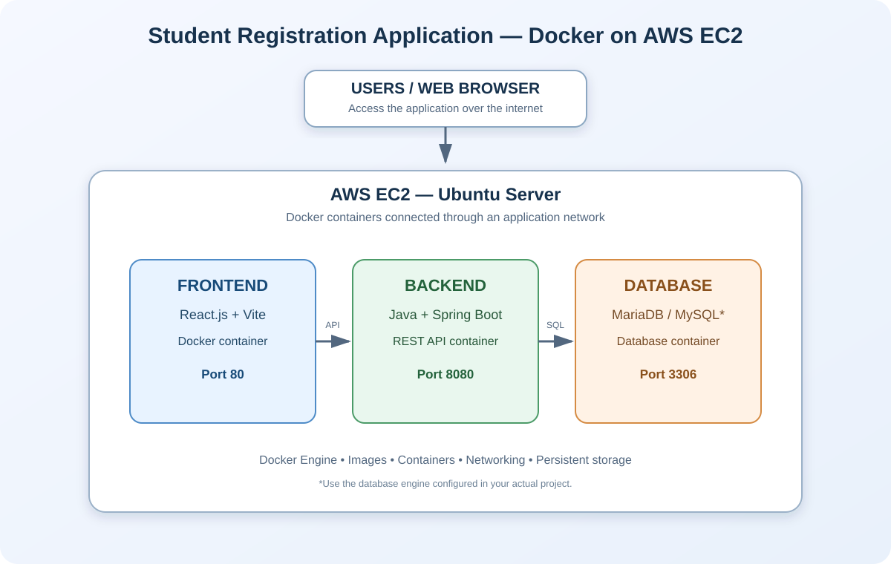

# Student Registration Application — Docker on AWS EC2



## 📌 Project Overview

The Student Registration Application is a full-stack web application developed using React.js, Spring Boot, and a relational database.

The application is containerized using Docker and can be deployed on an AWS EC2 Ubuntu server. The frontend, backend, and database run as separate services/containers, making the application modular, portable, and easier to manage.

This project demonstrates practical experience with Docker, AWS EC2, Linux, containerization, backend API deployment, database connectivity, and GitHub version control.

## 🛠️ Technology Stack

| Technology | Purpose |
|---|---|
| React.js | Frontend development |
| Vite | Frontend build tool |
| Java | Backend programming |
| Spring Boot | REST API development |
| MySQL | Relational database |
| Docker | Application containerization |
| AWS EC2 | Cloud deployment |
| Ubuntu Linux | EC2 operating system |
| Git | Version control |
| GitHub | Source code repository |
| SSH | Secure GitHub authentication |

> The database engine, ports, and service names should match the configuration in this repository.

## 🏗️ Application Architecture

The application uses three main components hosted on an AWS EC2 Ubuntu server:

- **Frontend:** React.js and Vite application
- **Backend:** Spring Boot REST API
- **Database:** MySQL relational database

The frontend sends API requests to the backend. The backend connects to the database over the Docker network.

### Docker Containers

| Component | Technology | Typical port |
|---|---|---|
| Frontend | React + Vite | 80 |
| Backend | Spring Boot | 8080 |
| Database | MySQL | 3306 |

*These are common example ports. Confirm the actual published ports in your Docker configuration.*

## ✨ Project Features

- Student registration functionality
- View registered student records
- React frontend and Spring Boot backend integration
- REST API implementation
- Relational database integration
- Docker image creation and container execution
- AWS EC2 cloud deployment
- GitHub source code management
- SSH-based GitHub authentication

## 📂 Project Structure

The exact directory and file names may vary based on the project files.

```text
student-registration-docker-aws/
├── frontend/
│   ├── src/
│   ├── public/
│   ├── Dockerfile
│   └── package.json
├── backend/
│   ├── src/
│   └── Dockerfile
├── database/                 # If database build files are included
├── docker-compose.yml         # If Compose is used
├── docs/
│   └── images/
│       └── student-registration-docker-aws-architecture.svg
└── README.md
```

## ☁️ AWS EC2 Deployment

### Step 1: Launch an EC2 Instance

1. Open the AWS Management Console.
2. Navigate to **EC2** and choose **Launch instance**.
3. Select an Ubuntu AMI.
4. Choose an instance type suitable for the application.
5. Create or select a key pair.
6. Configure the security group with only the ports required by your application.
7. Launch the instance.

### Step 2: Connect to EC2

From your local terminal, connect using your key pair:

```bash
ssh -i your-key.pem ubuntu@YOUR_EC2_PUBLIC_IP
```

Update Ubuntu:

```bash
sudo apt update
sudo apt upgrade -y
```

### Step 3: Install Docker and Git

```bash
sudo apt update
sudo apt install -y docker.io git
sudo systemctl enable --now docker
```

Verify the installation:

```bash
docker --version
docker ps
git --version
```

If your project uses Docker Compose, also verify that the Compose plugin is available:

```bash
docker compose version
```

## 🐳 Docker Containerization

### Step 1: Clone This Repository

```bash
git clone https://github.com/shivraj-kadam/student-registration-docker-aws.git
cd student-registration-docker-aws
```

### Step 2: Configure Application Settings

Configure the frontend API URL and backend database connection using the environment variables or configuration files expected by the project.

Example frontend API URL:

```env
VITE_API_URL=http://YOUR_EC2_PUBLIC_IP:8080/api
```

Replace the example address with the correct backend endpoint for your deployment. Do not commit real passwords, tokens, or other secrets.

### Step 3: Build Docker Images

If the repository contains separate Dockerfiles, build images using the correct paths:

```bash
docker build -t student-frontend:latest ./frontend
docker build -t student-backend:latest ./backend
```

Build a database image only if your project includes a custom database Dockerfile. Otherwise, use the configured official database image.

Check the available images:

```bash
docker images
```

### Step 4: Run the Containers

Use the actual image names, environment variables, ports, and network settings defined by your project.

If the repository includes a Docker Compose file, the usual commands are:

```bash
docker compose up -d --build
docker compose ps
docker compose logs -f
```

Stop the services:

```bash
docker compose down
```

> Removing volumes with `docker compose down -v` can permanently delete database data. Use it only when you intentionally want to remove that data.

## 🌐 Application Access

After deployment, open the frontend using the configured public address or domain:

```text
http://YOUR_EC2_PUBLIC_IP
```

Use the backend API URL configured for your application to test API requests. The exact endpoint depends on the routes implemented in the backend.

## 🧪 Testing and Verification

Check running containers:

```bash
docker ps
```

Check all containers:

```bash
docker ps -a
```

View container logs:

```bash
docker logs CONTAINER_NAME
```

If using Docker Compose:

```bash
docker compose ps
docker compose logs
docker compose config
```

## 🔄 Deployment Workflow

```text
Developer
   |
   v
Application Source Code
   |
   v
GitHub Repository
   |
   v
AWS EC2 Ubuntu Server
   |
   v
Build Docker Images
   |
   v
Run Docker Containers
   |
   +---- React Frontend
   |
   +---- Spring Boot Backend
   |
   +---- MySQL Database
   |
   v
Test the Application
   |
   v
Access through the EC2 public address/domain
```

## 🔐 GitHub SSH Configuration

SSH lets you authenticate with GitHub without entering your password for every Git operation.

Generate an ED25519 key on the machine where you will use Git:

```bash
ssh-keygen -t ed25519 -C "your-email@example.com"
```

Display the public key:

```bash
cat ~/.ssh/id_ed25519.pub
```

Add the public key to **GitHub → Settings → SSH and GPG keys**. Never share or upload the private key file.

Test authentication:

```bash
ssh -T git@github.com
```

Set this repository as the remote if needed:

```bash
git remote set-url origin git@github.com:shivraj-kadam/student-registration-docker-aws.git
git remote -v
```

Push your changes:

```bash
git add .
git commit -m "Update project"
git push origin main
```

## 🔧 Useful Docker Commands

Stop containers:

```bash
docker stop CONTAINER_NAME
```

Start an existing container:

```bash
docker start CONTAINER_NAME
```

Remove a container:

```bash
docker rm CONTAINER_NAME
```

Inspect a container:

```bash
docker inspect CONTAINER_NAME
```

View Docker images:

```bash
docker images
```

## 🔒 Security Best Practices

- Do not expose the database port publicly.
- Restrict SSH access to trusted IP addresses.
- Expose only the application ports that are required.
- Never commit database passwords, private keys, or cloud credentials to GitHub.
- Use environment variables or AWS Secrets Manager for sensitive configuration.
- Use HTTPS for production deployments.
- Keep Ubuntu packages and Docker images updated.

## 📚 What I Learned

- Installing and configuring Docker on Ubuntu Linux.
- Building and running Docker containers.
- Creating Docker images for application components.
- Connecting frontend, backend, and database services.
- Deploying a containerized application on AWS EC2.
- Configuring frontend-to-backend API communication.
- Checking container status and troubleshooting logs.
- Managing source code with Git and GitHub.
- Using SSH key-based authentication.

## 👨‍💻 Author

**Shivraj Kadam**

Cloud & DevOps Learner

GitHub: [shivraj-kadam](https://github.com/shivraj-kadam)

## 🔗 Project Repository

[student-registration-docker-aws](https://github.com/shivraj-kadam/student-registration-docker-aws)
